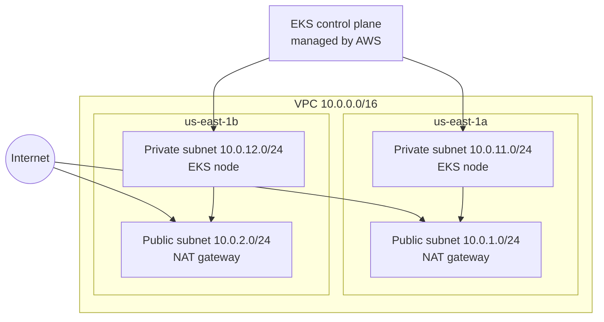

# cloud-platform

Infrastructure for an internal developer platform on AWS, written in
Terraform. It builds a multi-AZ network and an EKS cluster from reusable
modules, with remote state and per-environment configuration.

**Status:** networking and EKS are done. CI/CD, GitOps, preview environments,
and policy-as-code are next (see Roadmap).

## Architecture



## What is built

- **Remote state:** S3 bucket with versioning, encryption, public access
  blocked, and native state locking.
- **VPC module:** two availability zones, public and private subnets, an
  internet gateway, one NAT gateway per zone (behind an on/off variable), and
  an S3 gateway endpoint. Subnets are tagged for Kubernetes load balancers.
- **EKS module:** managed control plane, a managed node group across both
  zones, least-privilege IAM roles, and API-based cluster access.
- **Environment config:** `envs/dev` calls both modules and applies default
  tags to every resource.

## Repository layout

```
bootstrap/   one-time setup: creates the Terraform state bucket
modules/
  vpc/       reusable network module
  eks/       reusable EKS module
envs/
  dev/       dev environment: calls the modules, holds the backend config
docs/adr/    architecture decision records
```

## Design decisions

- [ADR 001: Remote state](docs/adr/001-remote-state.md)
- [ADR 002: VPC design](docs/adr/002-vpc-design.md)
- [ADR 003: EKS design](docs/adr/003-eks-design.md)

## Running it

Prerequisites: an AWS account with an SSO profile named `dev`, Terraform 1.10
or newer, the AWS CLI, and `kubectl`.

1. Create the state bucket (once). Change the bucket name in
   `bootstrap/main.tf` first, since S3 names are globally unique.
   ```
   cd bootstrap
   terraform init
   terraform apply
   ```
2. Build the environment (about 15 minutes).
   ```
   aws sso login --profile dev
   cd envs/dev
   terraform init
   terraform apply
   ```
3. Connect to the cluster and check it.
   ```
   aws eks update-kubeconfig --name dev-eks-cluster --region us-east-1 --profile dev
   kubectl get nodes
   ```
4. Tear it down when finished.
   ```
   terraform destroy
   ```

## Cost

With everything running, the environment costs roughly $0.27 an hour (EKS
control plane, two NAT gateways, two `t3.medium` nodes). It is meant to be
destroyed after each session. The VPC alone, with the NAT switch off, is free.

## Verified

- Both nodes joined the cluster and reported `Ready`, one in each zone.
- Cluster system pods ran, and a test deployment of two nginx pods was
  scheduled across both nodes.
- Deleting a pod caused the deployment to replace it automatically.
- The whole environment was destroyed and rebuilt from code.

## Roadmap

- GitHub Actions with OIDC (no stored AWS keys): fmt, validate, and a
  security scan on every pull request
- GitOps with ArgoCD
- Preview environments per pull request
- Policy-as-code to block insecure deployments
- Observability: metrics, logs, and alerts
- Hardening: restricted API endpoint, control plane logging, KMS secrets
  encryption, Pod Identity